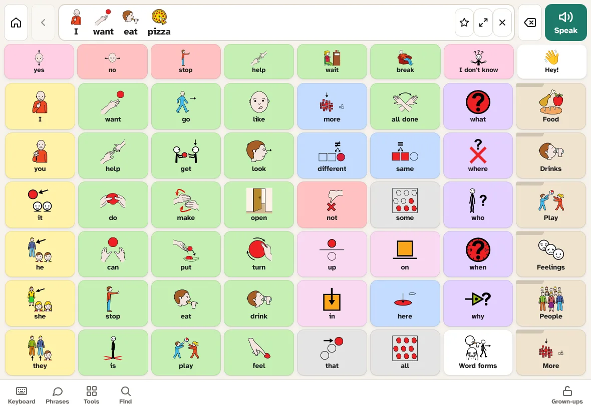

<p align="center"></p>

<h1 align="center">AACFree</h1>
<p align="center"><b>A free, open-source AAC app for autistic and non-verbal people and their families.</b><br>
Web app (installable PWA) · Android APK · Works offline · No ads, no subscriptions, no accounts</p>

---

AACFree is an **augmentative and alternative communication (AAC)** app: tap picture-and-word buttons to build sentences, and AACFree speaks them aloud. It is designed from what autistic AAC users, parents and speech-language pathologists say they need ([research notes](docs/research.md)).

**[Read the user guide](https://aacappfree.com/guide/)**: every screen, setting and tool explained step by step, with pictures, for parents, carers, teachers and therapists.

<p align="center"></p>

## Get it

| Platform | How |
|---|---|
| **Android** (7.0+) | Download [**aacfree.apk**](https://github.com/edrock200/aacfree/releases/latest/download/aacfree.apk) (always the newest version; changes are on the [Releases page](https://github.com/edrock200/aacfree/releases)), open it, and allow "install unknown apps". |
| **Any browser / iPad / iPhone / Chromebook / PC** | Open the web app at **[aacappfree.com/app](https://aacappfree.com/app/)** and choose **Install** / **Add to Home Screen**. No app store needed, and it then works offline. On iPhone/iPad, add it to the Home Screen so Safari keeps its data. |

New to AACFree? The [user guide](https://aacappfree.com/guide/) covers installing, first-time setup, [moving from another AAC app](https://aacappfree.com/guide/#moving-from-another-app) and [restoring a backup](https://aacappfree.com/guide/#restoring).

## Features

### For the person communicating
- **Motor-planning friendly core vocabulary.** Four home layouts: Big 4×3, Phone core 5×6, Medium 6×5, and Full 8×6 with the Universal Core words. Words never move. Hidden words keep their place. Big folders are split into fixed pages with Previous/Next buttons, with no scrolling.
- **25 topic folders, about 770 different words**, with 740 bundled [ARASAAC](https://arasaac.org) pictograms. Includes food, drinks, feelings, people, places, play, actions, describing words, little words, social, questions, body, clothes, animals, colours, numbers, time, school, routines, calm & sensory, weather, at home, tech & media, shopping, and health.
- **Modified Fitzgerald Key colour coding.** It can be filled, border-only, or turned off.
- **Bottom bar:** Keyboard, Phrases, Home, More (all topic folders in one tap), Tools, Find and Settings, all on screen even on small phones.
- **Always-on quick bar:** yes · no · stop · help · wait · break · I don't know · Hey! Protest words are always reachable.
- **Message bar:** speak (Speak turns into **Stop** while talking; on an empty bar it brings back the last message), delete a word (hold to clear, always with Undo), save as a phrase ★, show in big text (with a flip for the person across from you), share or copy.
- **Word forms on demand:** long-press a word, or tap it in the message bar, for go → went/going/goes, plurals, and bigger/biggest. A Word forms button is also on the Full layout.
- **Keyboard with private word prediction.** Uses the built-in dictionary plus the person's own vocabulary, and can optionally learn from their sentences. Next-word suggestions come from their history.
- **Phrases:** folder cards with pictures for ready-made Needs, Feelings, **Boundaries** ("Please stop", "I need space"), Chat, Questions and Emergency groups. Save favourites and scripts (gestalt language support), and record a custom voice for any phrase. **Recent sentences belong to the person:** they can delete one, clear them all, or turn on "Private for now", without the settings lock.
- **Tools:** visual schedule (Now/Next, check-off), first/then board, visual countdown timer, choice board, "How big is my feeling" scale, pain scale 0–10, body "where does it hurt", About-me card for new people and emergencies, drawing pad, a get-attention chime, and **My voice** (Quiet/Normal/Loud, speed, and "Show, don't speak"). Schedules reset each day. Tools the person doesn't use can be hidden in Settings.
- **Find word** shows the path to any word, even a hidden one, and walks through it button by button. If a word isn't on any board you can say it, put it in the message, or add it.
- **Modelling mode:** partners can demonstrate without their taps counting as the user's.
- **Pronunciations:** fix how the voice says names and unusual words.
- **Voices:** any device voice, with speed, pitch and volume. Record family voices on individual buttons.
- **Access:** hold-to-select, ignore repeated taps, select on touch, 1-switch auto scanning and 2-switch step scanning (rows → buttons or one by one, with optional auditory cues), any switch key (assign your own), switch acceptance time, a lockout after each selection, first-item delay, scan loops and a Leave-row step, two-tone highlights with your choice of colour and thickness, app-wide large text, light, dark and high-contrast themes, a calmer "Clean" style for teens and adults, reduced motion, and keep screen awake.
- **Babble mode** shows every hidden word so the person can explore.

- **English, Español, Français, Português:** full interface and vocabulary in each, with automatic verb conjugation. Use a different app language for settings, or show a second language on every button. Switching language keeps every button in place.
- **Eye gaze & head pointer:** dwell selection with a mouse, head-mouse or eye tracker, or the front camera (on-device). Dwell only starts after a real movement, pauses when the face is lost, and has Rest, Centre and Restart-camera controls.

### For parents, teachers and therapists
- **Settings** behind a 2-second hold (default), a PIN or a math question. One lock for the whole device, whichever profile is open. Talking itself is never locked; phrases always speak, and editing them needs the Edit pencil.
- **Symbol library:** every picture is organised into category folders, each with its own icon. Create your own categories (family, school, favourite shows…) and your own symbols from photos, online ARASAAC symbols or emoji. They appear whenever you choose a picture.
- **New categories on boards:** add a folder button with an icon in one tap. It can start empty or be filled from any library category.
- **Edit in place:** tap a button to change its label, spoken text, picture (built-in symbols, online ARASAAC search, emoji, camera or gallery photo), word type and colour, recorded voice, word forms, or folder link. Tap Move, then a target, to swap two buttons. **Hide instead of delete.** Undo is always available.
- Create folders and boards, resize boards (positions are preserved), and edit the quick bar.
- **Quick editing:** Show/Hide mode reveals words one tap at a time, and "+ Word" adds a word with a suggested picture. A full board gets a new row, and nothing moves.
- **Paper boards:** print any boards, with the quick bar on every page, as a low-tech backup.
- **Sync across devices, change by change.** Edits made on a parent's phone, a school tablet and the user's tablet are merged item by item, so nothing is lost when more than one device changed. Deletions carry over, and when the same button was changed in two places the newer change wins and the conflict is listed (a snapshot is kept first). **Automatic sync** goes through one file the family picks in Google Drive, OneDrive or Dropbox (Android, and desktop Chrome/Edge); iPad, iPhone and Firefox use Send/Receive files. Everything is encrypted with the family's passcode. There is no account and no AACFree server. Each device keeps its own voice, PIN and history settings.
- **Automatic backups** (daily, weekly or monthly, keeping as many copies as you like) that survive uninstalling. On Android they can also go straight to Google Drive, OneDrive, Dropbox or an SD card. Backups can be encrypted with a passcode and can leave out photos or message history.
- **Data safety:** every change is saved instantly, plus automatic daily snapshots and snapshots before any restore, import, layout change or delete (kept separately, so one never pushes out the other). Unreadable or newer-version data is never overwritten. Every loaded or imported file is checked and repaired first. A one-file backup (including photos and recordings) works for moving devices, and the app asks the browser to keep storage persistently.
- **Import a board from a picture.** Moving from TD Snap, Proloquo2Go, TouchChat, LAMP, Cboard or a paper board? Take a photo or screenshot of a board. AACFree finds the grid, reads every word on the device (no internet, no account) and rebuilds it with the same rows and columns, the same word in each square, a matching AACFree symbol and the colour of its word type, so the person keeps their motor plan. Fix any square before saving, mark folders, or keep the pictures from your screenshot for your family's own use. It becomes a new folder (nothing else moves) or a new profile, with a snapshot first.
- **Open Board Format** `.obz` export and import, to share boards with CoughDrop, Cboard and others.
- **Private usage insights** (opt-in): words per day, most-used words, new words, average message length and recent messages, with CSV export for your SLP. Nothing leaves the device.
- **Multiple profiles** on one device, synced like everything else.
- Built-in **Help & tips** on AAC best practice: modelling, presuming competence, not testing, and keeping the device available 24/7.
- Android: the Back button never exits the app. Use App pinning to stay in AACFree.

## Development

Requirements: Node 22+. For Android you also need JDK 21 and the Android SDK (platform 36); for iOS, a Mac with Xcode 16 or GitHub's macOS runners. See [`.claude/skills/build-android`](.claude/skills/build-android/SKILL.md).

```bash
npm install
npm run dev            # http://localhost:5173
npm test               # unit tests
npm run build          # typecheck + build web app → dist/
npm run build:site     # landing page + web app + APK → dist-site/
npm run android:apk    # build signed release APK → release/aacfree-latest.apk
```

Project guide for contributors and AI agents: [CLAUDE.md](CLAUDE.md). Changing the default words: [add-vocabulary skill](.claude/skills/add-vocabulary/SKILL.md).

### Website
`.github/workflows/pages.yml` publishes `dist-site/` to GitHub Pages on every push to `main`: the landing page at `/`, the user guide at `/guide/` (from `site/guide/`; regenerate its screenshots with `npm run guide:shots`), the web app at `/app/`, and the APK at `/download/aacfree.apk`. Enable it under **Settings → Pages → Source: GitHub Actions**; the `github-pages` environment must allow deploys from `main`. The site is served at the custom domain **https://aacappfree.com** (set in Settings → Pages), with the web app at `/app/`.

### Android builds
`.github/workflows/android.yml` builds the APK on pull requests. When you push a tag like `v1.0.1`, it also attaches the APK to a GitHub Release.

**Signing.** Release APKs are signed with a private key that is **never committed**. Locally, put it in `android/signing/` and describe it in `android/keystore.properties` (both git-ignored):
```properties
storeFile=signing/release.jks
storePassword=…
keyAlias=<your key alias>
keyPassword=…
```
For CI, add the repository secrets `ANDROID_KEYSTORE_BASE64` (`base64 -w0 release.jks`), `ANDROID_KEYSTORE_PASSWORD`, `ANDROID_KEY_ALIAS` and `ANDROID_KEY_PASSWORD`. Without them, CI builds a debug-signed APK. **Always sign updates with the same key.** Android refuses to install an update signed with a different key, and uninstalling first erases the app's data. Save a backup file first (Settings → Backup).

Signed runs also build the Google Play app bundle (`aacfree-v<version>.aab`, the **aacfree-play-bundle** artifact of the run). The Android package id is `com.aacappfree.app` (from 0.8.0). Publishing on Google Play: [`docs/play-store.md`](docs/play-store.md).

### iPhone and iPad builds
The iOS app is the same web app in a Capacitor shell (`ios/`, Swift Package Manager, iOS 16.4+, bundle id `com.aacappfree.app`). Its two native plugins are in `ios/App/App/AACFreePlugins.swift`. `.github/workflows/ios.yml` builds it for the Simulator on every pull request; run it by hand with **upload** to sign it and send it to TestFlight (needs the App Store Connect API key secrets). With a Mac: `npm run build && npx cap sync ios && npx cap open ios`. Publishing on the App Store: [`docs/app-store.md`](docs/app-store.md).

## Roadmap / ideas
- More languages (each is a pack in `src/i18n/packs.ts`: UI strings, vocabulary, words, grammar, keyboard)
- **Sign mode** (key word signing): an optional setting that shows a short looping sign clip for each button.
  1. Families record their own sign clips with the camera in the button editor, the same way voice recordings work now. This needs no licence and supports home signs and Makaton.
  2. Add a pack format for downloadable sign sets, kept offline after download rather than bundled, because about 800 clips is around 80 MB.
  3. Find a licensed set. Leads: ARASAAC's Spanish Sign Language (LSE) videos; ASL-LEX or ASL Signbank (videos need permission); Makaton (needs a licence); or paid recordings by a Deaf signer released under an open licence. Signs should be checked by Deaf signers.
  - Show a still frame on each button and play the clip on press or in the message bar. Looping every cell at once is too heavy on cheap tablets and overwhelming for many users.
  - Avoid AI or avatar signing.
- Publish on Google Play (everything is prepared; it needs the owner's developer account; see docs/play-store.md)
- From the v0.4 review (see [docs/reviews/v0.4-review.md](docs/reviews/v0.4-review.md)):
  - switching language mid-conversation, with each language remembering its own voice;
  - a larger layout that adds words without moving any existing ones;
  - an iPad app;
  - temporary word sets for an activity, and saved First/Then and Choices setups;
  - highlighting each word as it's spoken;
  - better prediction (spelling mistakes, abbreviations);
  - importing audio files for scripts;
  - a grammatical gender setting for Spanish, French and Portuguese;
  - importers for Grid, TD Snap and TouchChat boards;
  - skin-tone options for people symbols;
  - social stories and visual scene boards.

Suggestions are welcome. Open an issue.

## Privacy
AACFree has no servers, analytics, ads or accounts. On Android, the system's own Auto Backup may include the app's data in the family's Google account backup. That is a safety net Android provides, and you can turn it off in Android settings. Boards, photos, recordings, settings and the optional usage log are stored only on the device, in IndexedDB. The app goes online only when you search for more symbols, when a picture that isn't bundled is downloaded from ARASAAC (you can turn this off in Settings → Lock → Privacy), or when the device's text-to-speech engine uses an online voice.

- **Sync** writes only to a file the family chooses (for example in Google Drive), encrypted with the family's passcode. The passcode and this device's settings never leave the device.
- **Recent sentences** can be deleted by the person, kept only until AACFree restarts, or turned off. "Private for now" pauses recent sentences, learned words and the usage log.
- **Import a board from a picture** reads the words with text recognition that runs on the device (Tesseract, bundled with the app). The picture is never uploaded and nothing is downloaded while it works.
- **Backups:** plain (unencrypted) backups never contain the settings PIN. New installs leave recent sentences out of backups unless you include them.

## Credits and licence
- App code: [GNU AGPL-3.0-or-later](LICENSE). If you run a modified version for others, including as a website, you must share its source. See [NOTICE](NOTICE).
- Pictograms: Sergio Palao. Origin: [ARASAAC](https://arasaac.org), Government of Aragón (Spain). Licence: [CC BY-NC-SA 4.0](https://creativecommons.org/licenses/by-nc-sa/4.0/). Because the pictograms are non-commercial, AACFree must stay free.
- Font: [Atkinson Hyperlegible](https://brailleinstitute.org/freefont), Braille Institute (SIL OFL 1.1)
- On-device text recognition for picture import: [tesseract.js](https://github.com/naptha/tesseract.js) and tesseract.js-core (Apache-2.0), with Tesseract language data from [@tesseract.js-data](https://github.com/naptha/tessdata) (`4.0.0_best_int`, MIT; English, Spanish, French, Portuguese)

AACFree is not a medical device. Please work with a speech-language pathologist when choosing and setting up AAC.
