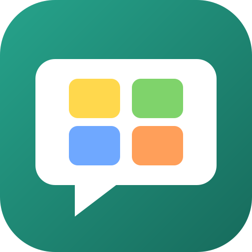

<p align="center"></p>

<h1 align="center">Caleb</h1>
<p align="center"><b>A free, open-source AAC app for autistic people and their families.</b><br>
Web app (installable PWA) · Android APK · Works offline · No ads, no subscriptions, no accounts</p>

---

Caleb is an **augmentative and alternative communication (AAC)** app: tap picture-and-word buttons to build sentences, and Caleb speaks them aloud. It is designed from what autistic AAC users, parents and speech-language pathologists say they need ([research notes](docs/research.md)).

<p align="center"></p>

## Get it

| Platform | How |
|---|---|
| **Android** (7.0+) | Download [`release/caleb-latest.apk`](release/caleb-latest.apk) (v0.3), open it, and allow "install unknown apps". |
| **Any browser / iPad / iPhone / Chromebook / PC** | Open the web app (GitHub Pages, see [Website](#website)) and choose **Install** / **Add to Home Screen**. It then works offline. |

## Features

### For the person communicating
- **Motor-planning friendly core vocabulary.** Four home layouts: Big 4×3, Phone core 5×6, Medium 6×5, and Full 8×6 with the Universal Core words. Words never move. Hidden words keep their place. Big folders are split into fixed pages with Previous/Next buttons, with no scrolling.
- **25 topic folders, about 770 different words**, with 740 bundled [ARASAAC](https://arasaac.org) pictograms. Includes food, drinks, feelings, people, places, play, actions, describing words, little words, social, questions, body, clothes, animals, colours, numbers, time, school, routines, calm & sensory, weather, at home, tech & media, shopping, and health.
- **Modified Fitzgerald Key colour coding.** It can be filled, border-only, or turned off.
- **Always-on quick bar:** yes · no · stop · help · wait · break · I don't know · Hey! Protest words are always reachable.
- **Message bar:** speak, delete a word (hold to clear), save as a phrase ★, show in big text (with a flip for the person across from you), share or copy.
- **Word forms on demand:** long-press a word, or tap it in the message bar, for go → went/going/goes, plurals, and bigger/biggest. A Word forms button is also on the Full layout.
- **Keyboard with private word prediction.** Uses the built-in dictionary plus the person's own vocabulary, and can optionally learn from their sentences. Next-word suggestions come from their history.
- **Phrases:** ready-made Needs, Feelings, **Boundaries** ("Please stop", "I need space"), Chat, Questions and Emergency groups. Save favourites and scripts (gestalt language support), keep recent sentences, and record a custom voice for any phrase.
- **Tools:** visual schedule (Now/Next, check-off), first/then board, visual countdown timer, choice board, "How big is my feeling" scale, pain scale 0–10, body "where does it hurt", About-me card for new people and emergencies, drawing pad, and a get-attention chime.
- **Find word** shows the path to any word, even a hidden one, and walks through it button by button. If a word isn't on any board you can say it, put it in the message, or add it.
- **Modelling mode:** partners can demonstrate without their taps counting as the user's.
- **Pronunciations:** fix how the voice says names and unusual words.
- **Voices:** any device voice, with speed, pitch and volume. Record family voices on individual buttons.
- **Access:** hold-to-select, ignore repeated taps, select on touch, 1-switch auto scanning and 2-switch step scanning (rows → buttons or one by one, with optional auditory cues), Bluetooth switch keys (Space/Enter), large text, light, dark and high-contrast themes, a calmer "Clean" style for teens and adults, reduced motion, and keep screen awake.
- **Babble mode** shows every hidden word so the person can explore.

- **English and Español:** a full Spanish interface and vocabulary, with automatic verb conjugation. Switching language keeps every button in place.
- **Eye gaze & head pointer:** dwell selection with a mouse, head-mouse or eye tracker, or the front camera (on-device).

### For parents, teachers and therapists
- **Grown-up area** behind a 2-second hold (default), a PIN or a math question. Talking itself is never locked.
- **Symbol library:** every picture is organised into category folders, each with its own icon. Create your own categories (family, school, favourite shows…) and your own symbols from photos, online ARASAAC symbols or emoji. They appear whenever you choose a picture.
- **New categories on boards:** add a folder button with an icon in one tap. It can start empty or be filled from any library category.
- **Edit in place:** tap a button to change its label, spoken text, picture (built-in symbols, online ARASAAC search, emoji, camera or gallery photo), word type and colour, recorded voice, word forms, or folder link. Tap Move, then a target, to swap two buttons. **Hide instead of delete.** Undo is always available.
- Create folders and boards, resize boards (positions are preserved), and edit the quick bar.
- **Quick editing:** Show/Hide mode reveals words one tap at a time, and "+ Word" adds a word with a suggested picture. A full board gets a new row, and nothing moves.
- **Paper boards:** print any boards, with the quick bar on every page, as a low-tech backup.
- **Encrypted sync** between a parent's phone and the user's tablet, with no account or server.
- **Weekly automatic backup file** that survives uninstalling (Android: Documents/Caleb).
- **Data safety:** every change is saved instantly, plus automatic daily snapshots (the last 15) and snapshots before any restore, import or layout change. A one-file backup (including photos and recordings) works for moving devices, and the app asks the browser to keep storage persistently.
- **Open Board Format** `.obz` export and import, to share boards with CoughDrop, Cboard and others.
- **Private usage insights** (opt-in): words per day, most-used words, new words, average message length and recent messages, with CSV export for your SLP. Nothing leaves the device.
- **Multiple profiles** on one device.
- Built-in **Help & tips** on AAC best practice: modelling, presuming competence, not testing, and keeping the device available 24/7.
- Android: the Back button never exits the app. Use App pinning to stay in Caleb.

## Development

Requirements: Node 22+. For Android you also need JDK 21 and the Android SDK (platform 36). See [`.claude/skills/build-android`](.claude/skills/build-android/SKILL.md).

```bash
npm install
npm run dev            # http://localhost:5173
npm test               # unit tests
npm run build          # typecheck + build web app → dist/
npm run build:site     # landing page + web app + APK → dist-site/
npm run android:apk    # build signed release APK → release/caleb-latest.apk
```

Project guide for contributors and AI agents: [CLAUDE.md](CLAUDE.md). Changing the default words: [add-vocabulary skill](.claude/skills/add-vocabulary/SKILL.md).

### Website
`.github/workflows/pages.yml` publishes `dist-site/` to GitHub Pages on every push to `main`: the landing page at `/`, the web app at `/app/`, and the APK at `/download/caleb-latest.apk`. Enable it under **Settings → Pages → Source: GitHub Actions**. The site will then be at `https://<user>.github.io/caleb/`.

### Android builds
`.github/workflows/android.yml` builds the APK on pull requests. When you push a tag like `v1.0.1`, it also attaches the APK to a GitHub Release.

**Signing.** Release APKs are signed with a private key that is **never committed**. Locally, put it in `android/signing/` and describe it in `android/keystore.properties` (both git-ignored):
```properties
storeFile=signing/release.jks
storePassword=…
keyAlias=caleb
keyPassword=…
```
For CI, add the repository secrets `ANDROID_KEYSTORE_BASE64` (`base64 -w0 release.jks`), `ANDROID_KEYSTORE_PASSWORD`, `ANDROID_KEY_ALIAS` and `ANDROID_KEY_PASSWORD`. Without them, CI builds a debug-signed APK. **Always sign updates with the same key.** Android refuses to install an update signed with a different key, and uninstalling first erases the app's data. Save a backup file first (Grown-ups → Backup).

## Roadmap / ideas
- More languages after Spanish (the translation system is ready: add `src/i18n/<lang>.ts` and `src/data/i18n/<lang>-vocab.ts`)
- Bilingual mode: show two languages on each button
- Publish on Google Play (everything is prepared; it needs the owner's developer account; see docs/play-store.md)

Suggestions are welcome. Open an issue.

## Privacy
Caleb has no servers, analytics, ads or accounts. On Android, the system's own Auto Backup may include the app's data in the family's Google account backup. That is a safety net Android provides, and you can turn it off in Android settings. Boards, photos, recordings, settings and the optional usage log are stored only on the device, in IndexedDB. The app goes online only when you search for more symbols, or when the device's text-to-speech engine uses an online voice.

## Credits and licence
- App code: [GNU AGPL-3.0-or-later](LICENSE). If you run a modified version for others, including as a website, you must share its source. See [NOTICE](NOTICE).
- Pictograms: Sergio Palao. Origin: [ARASAAC](https://arasaac.org), Government of Aragón (Spain). Licence: [CC BY-NC-SA 4.0](https://creativecommons.org/licenses/by-nc-sa/4.0/). Because the pictograms are non-commercial, Caleb must stay free.
- Font: [Atkinson Hyperlegible](https://brailleinstitute.org/freefont), Braille Institute (SIL OFL 1.1)

Caleb is not a medical device. Please work with a speech-language pathologist when choosing and setting up AAC.
